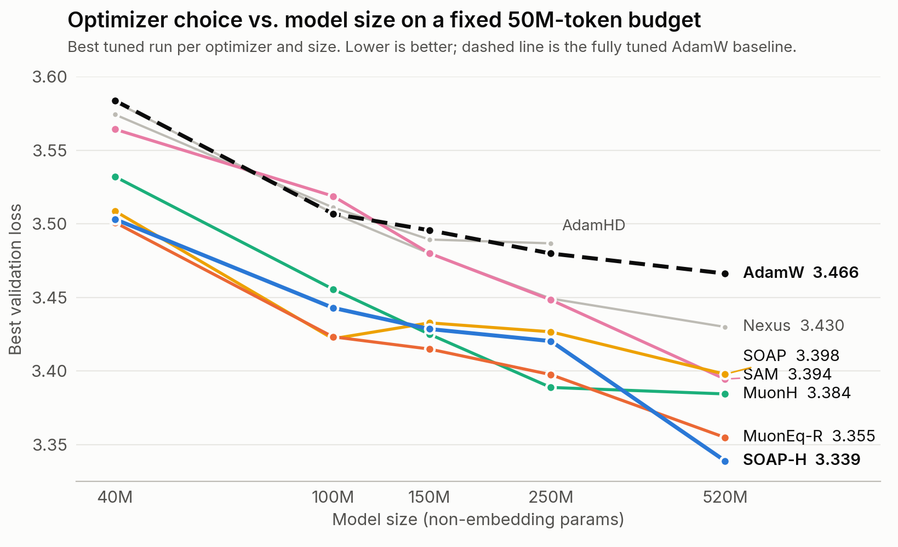

# sloptimizers

Since AdamW (2017), hundreds of optimizer variants ("sloptimizers") have been published, but basically only one outside of Adam has made large-scale pretraining (Muon). Between the modded-nanogpt speedrun's optimization track and other optimizer competitions, there's a lot of work on optimizer convergence and compute efficiency, but the field still lacks a good metric for how sample efficient an optimizer is. Towards this problem, we find common intuitions such as deep learning generalization measures or sharpness also fail us. We spent some compute sweeping in a controlled setting to find out :)

We study a variety of implicit (choice of optimizer) and explicit (L1 norm, WD, etc.) regularization techniques trained on a fixed amount of data, under controlled settings following [Fantastic Pretraining Optimizers and Where to Find Them](https://arxiv.org/abs/2509.02046) and [Pre-training under Infinite Compute](https://arxiv.org/abs/2509.14786).

Kaitlyn Wang, Alan Xiao, Revant Kasichainula

This work is ongoing, blog post coming soon!

<picture>
  <source media="(prefers-color-scheme: dark)" srcset="assets/val_loss_vs_size_dark.png">
  
</picture>

## What we've tried so far

- Adam variants (AdamW, AdamHD)
- L1 / Huber weight decay
- Second-order and preconditioned optimizers (SOAP, Muon, layer-wise Gauss-Newton)
- Norm-constrained updates (Hyperball)
- SAM and Nexus
- Generalization measures from [Fantastic Generalization Measures and Where to Find Them](https://arxiv.org/abs/1912.02178) (norm, spectral, sharpness and PAC-Bayes based)

## Code

PyTorch implementations of the optimizers and generalization measures are in `sloptimizers/`, with tiny examples in `examples/`.

```bash
pip install -e .
python examples/train_tiny.py --optimizer muoneq-r
python examples/sweep_tiny.py --optimizer muoneq-r
```

`sloptimizers/sweep.py` runs a locally optimal hyperparameter sweep.

## License

MIT
